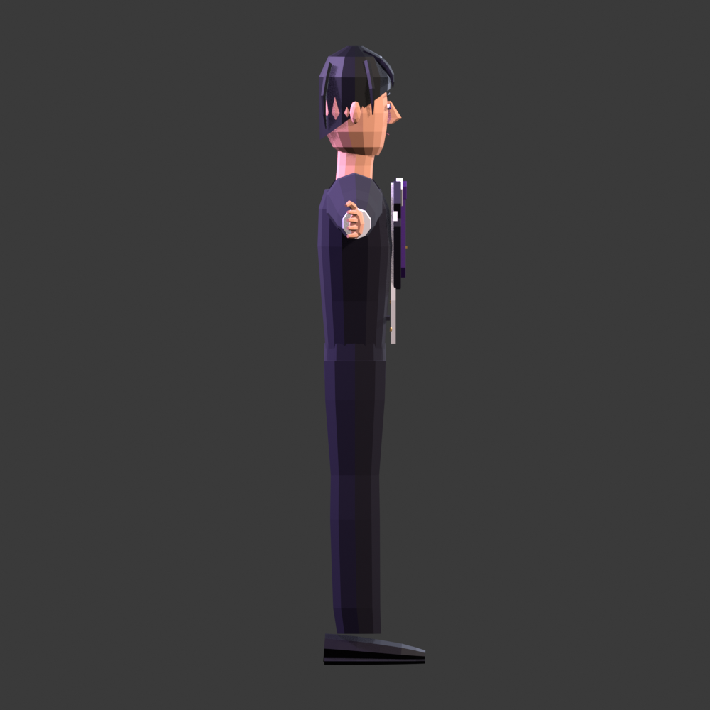
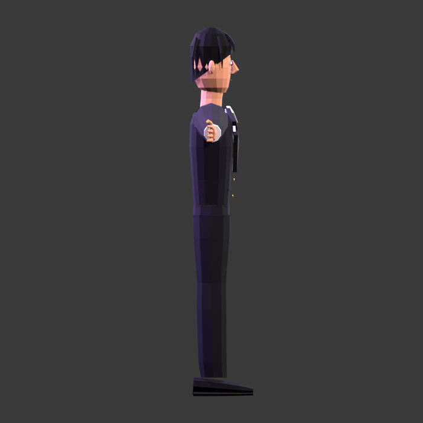
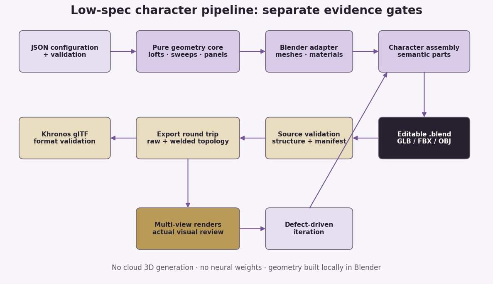
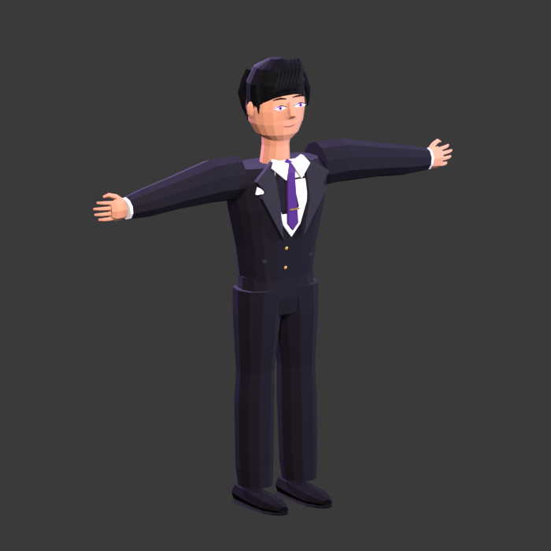
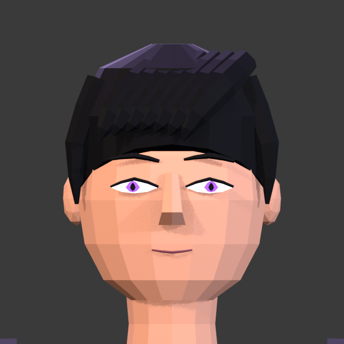
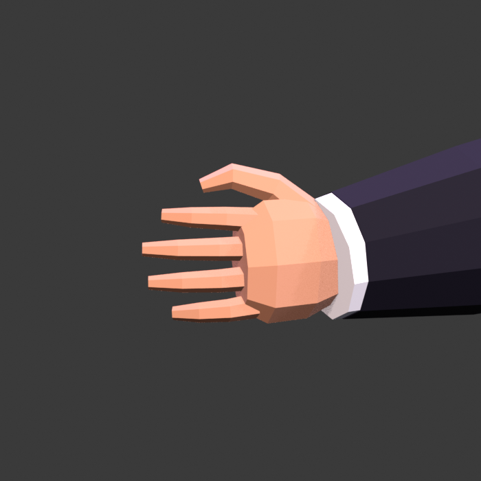

# Building Better Editable 3D Characters on Low-Spec Hardware

**Research and implementation report — 2026-10-30**  
**Project audited:** [KingxKingT/forced-3d-character](https://github.com/KingxKingT/forced-3d-character)  
**Baseline:** 11th-generation Intel Core i3, 8 GB RAM, Intel integrated graphics, no dedicated GPU  
**Delivered implementation:** `forced-3d-character-improved/` and the tested example in `character-example-v2/`

## Executive summary

The correct response is **not** to replace the repository with a large neural stack or a collection of sophisticated-sounding wrappers. The existing project already has a useful command-line contract, JSON validation, deterministic mesh creation, selective BMesh use, export helpers, and unusually honest documentation. Its central weakness is visual rather than architectural: the original character is still a primitive-based blockout with a box torso, ellipsoid head, simple hair masses, palm cubes, straight fingers, and shoe cubes. The recommended path is therefore a targeted refactor. Preserve the entry point and configuration, move reusable geometry into pure Python, introduce profile lofts and stable-frame sweeps, fit clothing to the body, and validate both structure and actual renders. Blender’s documented mesh API supports explicit vertex/face construction and loop-triangle inspection, which is sufficient for this lightweight route without any neural dependency ([Blender Mesh API](https://docs.blender.org/api/current/bpy.types.Mesh.html)).

The delivered implementation follows that path and has been executed rather than merely proposed. Blender 4.2.3 LTS generated a 65-object static character with **2,002 base vertices, 3,744 base triangles, and 3,976 evaluated triangles**. Strict source checks passed; GLB re-import passed; the official Khronos validator returned zero errors, warnings, infos, and hints. Front, side, back, three-quarter, head, and right-hand renders were actually inspected. The first side render exposed floating clothing panels, which were then fitted to the torso and re-rendered. This establishes a functioning editable low-poly generator and a real visual iteration, not a production anime sculpt, rigged character, reference-matched likeness, or performance benchmark on the user’s computer. The exact evidence and unperformed tests are recorded in [the verification report](forced-3d-character-improved/VERIFICATION.md).

### Principal recommendations

| Recommendation | Reason | Delivered status |
|---|---|---|
| Preserve CLI, JSON, export conventions, and honest limitations | Existing contracts are useful; rewriting everything adds risk without improving silhouettes | Preserved and extended |
| Add pure Python loft/sweep/panel algorithms | Fast tests, deterministic geometry, reusable across agents | `scripts/geometry_core.py` |
| Keep Blender adaptation thin | `bpy` should handle scene objects, materials, rendering, and export—not all geometric reasoning | `scripts/blender/mesh_tools.py` |
| Spend geometry on head, hair, hands, clothing fit, and shoes | These are the original model’s largest visible weaknesses | Rebuilt with lofts, sweeps, and fitted panels |
| Treat static component topology and animation topology as different products | Closed overlapping objects can be valid static assets but are not deformation certification | Explicit in skill, validator, and report |
| Separate Python, Blender, export, and visual evidence | A script run, a manifold mesh, a valid GLB, and an attractive character are different claims | Four test gates plus actual visual review |
| Keep external bases and neural tools optional | Low-spec local generation must remain complete without downloads or services | No third-party assets or weights bundled |

## 1. What makes a character visually good rather than merely valid

A structurally valid mesh answers questions such as whether face indices exist, coordinates are finite, edges have acceptable face counts, adjacent faces wind consistently, and exported buffers obey the target format. Those checks are necessary but fundamentally incomplete. A cube-headed figure can be closed, consistently wound, material-tagged, and valid glTF while remaining a poor character. Visual quality additionally depends on proportion, silhouette, anatomical landmarks, profile depth, edge placement, component transitions, hair direction, clothing fit, material response, and camera readability. Blender’s BMesh API provides operations and connectivity access, but it does not infer where eyelid, shoulder, knuckle, or lapel loops belong ([Blender BMesh API](https://docs.blender.org/api/current/bmesh.html)). Automatic retopology likewise cannot infer every artistically necessary semantic loop, especially when the target deformation has not been specified.

The practical consequence is that “more geometry” is not a reliable first remedy. A small number of deliberately placed profile rings can outperform a dense but shapeless primitive. A hand needs a palm taper, four varied finger lengths, joint bends, and an opposed thumb before it needs fingernails. A suit needs a chest/waist relationship and panels that follow its depth before it needs buttons or texture. Hair needs a scalp mass and a small set of directed locks before it needs strand detail. Research on hair representations supports generalized cylinders, control curves, and cross-sectional variation as useful ways to describe wisps and locks; the delivered generator adapts those high-level ideas with original lightweight sweep code rather than using a neural hair model ([Hair Meshes](https://www.cemyuksel.com/research/hairmeshes/hairmeshes.pdf), [CHARM](https://arxiv.org/html/2509.21114v1)).

### Static validity versus deformation readiness

The delivered generator intentionally uses closed, separate component meshes that may overlap at shoulders, wrists, clothing layers, and hair masses. This is a legitimate static low-poly strategy because each part remains editable and cheap to construct. It is not automatically suitable for animation. Deformation requires an explicit decision about continuous skin or separately skinned components, joint loop placement, skin weights, corrective shapes, and range-of-motion behaviour. SMPL illustrates the value of a fixed template, learned shape/pose offsets, joint regression, and skinning in a coherent character system; it does not imply that arbitrary closed primitives become animation-ready after remeshing. Its model and data are not copied into this project ([SMPL paper](https://files.is.tue.mpg.de/black/papers/SMPL2015.pdf)).

This distinction should constrain both code and language. The current validator can require each object to be closed and single-component, but it cannot certify an elbow’s deformation. A rig added to overlapping static parts may produce acceptable limited motion after careful weighting, or it may expose intersections immediately; only animation tests can decide. The correct roadmap is therefore to improve the static visual generator first, then design a separate deformation-topology milestone if animation is required. Calling the current output “game-ready” would also require a target engine, material and draw-call review, UV/texture decisions, and performance measurements. A successful static GLB round trip establishes none of those additional properties.

## 2. Brutally honest repository evaluation

The upstream repository was inspected from the `main`-branch archive on 2026-10-30; the observed Git tree SHA was `d913cf9bb162ce3022e6620deccf393713bcbc4f`. The original [character generator](https://github.com/KingxKingT/forced-3d-character/blob/main/scripts/blender/create_character.py) already avoids context-sensitive primitive-add operators, validates `Mesh.from_pydata` input through `Mesh.validate`, uses BMesh for icospheres, and checks export completion. Those are good foundations. The weakness is that most major forms still come from cubes, ellipsoids, and two-ring segments. The result is useful as a blockout but insufficient for the requested head, solid hair locks, natural hands, and tailored suit. The appropriate response is component-level replacement, not disparagement of the whole project.

The original [mesh validator](https://github.com/KingxKingT/forced-3d-character/blob/main/scripts/blender/validate_mesh.py) correctly avoids treating every boundary or triangle-budget warning as fatal, and the original [round-trip validator](https://github.com/KingxKingT/forced-3d-character/blob/main/scripts/blender/validate_character.py) explicitly disclaims visual, rigging, UV, and animation certification. However, important defects were not covered: duplicate faces, zero-length edges, winding conflicts, negative closed-mesh volume, disconnected components, non-planar polygons, and missing semantic parts. The old tests also asserted that particular strings appeared in source code. Such assertions can protect an implementation preference, but they cannot show that a generated loft is closed or a reversed face is detected. The improved suite replaces those brittle checks with geometry fixtures and real Blender execution.

### Keep, replace, complete, remove, and add

| Area | Verdict | Honest assessment and action |
|---|---|---|
| CLI and JSON configuration | **Keep** | Stable, useful, already validates scale, colours, features, render settings, and exports. Extended only where needed. |
| `Mesh.from_pydata` creation pattern | **Keep and centralize** | Good deterministic boundary. Input validation now occurs before Blender and correction by `Mesh.validate` is rejected. |
| BMesh ico detail helper | **Keep selectively** | Appropriate for ears/buttons; inappropriate as the main answer for head, hair, and body. |
| Import/export helpers | **Keep and verify** | Selected-mesh export and evaluated modifiers are useful. GLB extras now preserve semantic metadata; runtime tests use Python exit codes. |
| Torso, pelvis, neck, legs | **Replace visually** | Bevelled boxes and simple segments became profile lofts with rounded-rectangle/elliptical sections. |
| Head and face | **Replace visually** | Single ellipsoid became jaw/cheek/temple/forehead rings with shaped eyes, lids, brows, nose, and mouth. |
| Hair | **Replace visually** | Cap plus ellipsoid locks became scalp-following cap and solid swept locks with width/thickness taper. |
| Hands | **Replace visually** | Palm cubes and straight fingers became lofted palms, jointed varied fingers, and opposed thumbs. |
| Clothing panels | **Complete and correct** | Explicit panels were the right lightweight idea, but needed torso fitting and a restrained shirt opening. |
| Structural validator | **Extend** | Added duplicates, zero-length edges, winding, volume, components, planarity, semantics, and evaluated counts. |
| Round-trip validator | **Extend** | Added structural checks, semantic checks, and analysis-only welding to account for normal/attribute splits. |
| Source-text tests | **Remove as geometry evidence** | Replaced with pure algorithm tests and optional real Blender integration. |
| Documentation honesty | **Keep and strengthen** | Structural success and artistic quality remain separate; unperformed checks are marked `not_tested`. |
| Neural/high-spec backend | **Keep optional and external** | No reason to make it a baseline dependency or download weights. |
| Third-party bases | **Missing optional path** | CC0 route documented, but not bundled or required. |

### Redundancy and missing systems

The project does not need a second mandatory procedural framework. Geometry Nodes and curve bevels are useful authoring options, but introducing them alongside explicit meshes, BMesh, lofts, and sweeps as required layers would increase cognitive and testing cost without guaranteed visual gain. Blender’s curve geometry and Curve to Mesh node already provide documented profile-sweep mechanisms for users who prefer node/curve authoring; the delivered code keeps those as alternatives rather than dependencies ([Blender curves](https://docs.blender.org/manual/en/latest/modeling/curves/properties/geometry.html), [Curve to Mesh](https://docs.blender.org/manual/en/latest/modeling/geometry_nodes/curve/operations/curve_to_mesh.html)). Likewise, blanket removal of every `bpy.ops` call would be counterproductive because import/export and scene saving are operator-driven in the current workflow.

The genuinely missing systems were fast reusable geometry tests, semantic part checks, fitted clothing, source-scene saving, explicit visual review, and a scalable plan for character variation. Shared topology with parameter or morph offsets is the sensible next step for reusable families because it preserves component correspondence while changing proportions. MPFB, CharMorph, SMPL, and MANO demonstrate related fixed-template or morph-based approaches, although their code and data licences differ and must not be collapsed into “free to copy” ([MPFB licence](https://static.makehumancommunity.org/about/license.html), [CharMorph documentation](https://charmorph-docs.readthedocs.io/en/main/Introduction.html), [MANO](https://mano.is.tue.mpg.de/)). The delivered generator establishes deterministic parts and manifests but does not pretend already to provide a full morph library.

## 3. Modelling techniques compared

No single modelling method dominates every component. Explicit meshes are best when the desired vertices and faces are known; BMesh is best for topology operations; lofts are efficient for profile-driven anatomy and clothing; sweeps are efficient for locks, fingers, and sleeves; panels are efficient for tailored design details; curves and Geometry Nodes are useful optional authoring layers; sculpting and retopology serve different organic and deformation needs. Blender’s Bevel modifier also remains useful for small controlled edge highlights, but its width, overlap, and evaluated triangle cost must be checked at the model’s scale ([Blender Bevel](https://docs.blender.org/manual/en/latest/modeling/modifiers/generate/bevel.html)).

The key selection criterion is not ideological purity. It is whether the representation exposes the artistic variables that matter. A head needs profile depths and widths at chin, jaw, cheeks, temples, and forehead. A hair lock needs path, width, thickness, taper, and stable orientation. A lapel needs a designed outline and a fitted offset from the torso. A full neural model is unnecessary to express those parameters. Conversely, a few lines of procedural code cannot guarantee a professional likeness; they only make the geometry editable and the iteration reproducible.

### Technique decision table

| Technique | Strengths | Weaknesses / cost | Best use here | Low-spec fit |
|---|---|---|---|---|
| Direct `Mesh.from_pydata` | Deterministic, explicit, no selection context, easy to serialize | Does not design topology or repair poor shapes; arrays need validation | Panels, caps, custom solids, final arrays from pure algorithms | **Excellent** |
| BMesh | Rich topology editing, connectivity inspection, procedural primitives | Can still create bad coordinates/winding; API overhead if used for everything | Small organic details, edits, connectivity inspection | **Excellent when selective** |
| Horizontal/profile loft | Few parameters control silhouette and section depth; consistent ring topology | Ring correspondence and cap design required; abrupt profiles create faceting | Head, neck, torso, trousers, palms | **Excellent** |
| Catmull–Rom swept volume | Designed path, taper, width/thickness; reusable for many parts | Frame flips/self-intersection possible; samples increase triangles and twisted quads | Hair, fingers, sleeves, shoe lasts | **Excellent with modest samples** |
| Solid XZ panel extrusion | Precise graphic outline and editable thickness | Constant-depth panels float; fitted n-gons become non-planar | Lapels, collar, tie, eye lenses | **Excellent with fitting** |
| Curves with bevel | Interactive path editing and documented geometry controls | Twist/radius and conversion must be inspected; another representation | Piping, strand/lock authoring option | **Good, optional** |
| Geometry Nodes | Reusable non-destructive parametric systems and profile sweeps | Node complexity, evaluation/debugging cost, version-specific workflows | Optional parametric detail systems | **Good but not mandatory** |
| Modifiers/bevels | Non-destructive edge highlights and reusable edits | Evaluated counts and overlap can surprise; large widths destroy detail | Small panel edges and working-source flexibility | **Good when restrained** |
| Sculpting | Direct organic art direction and surface refinement | Harder to make deterministic; dense meshes and manual skill | Later face/hair polish | **Optional, not required** |
| Automatic retopology | Can produce more uniform quad surfaces from dense input | Does not infer semantic deformation loops; build/dependency cost | Later animation-oriented experiment | **Optional, not a quality guarantee** |
| Shared base + morphs | Reusable anatomy, consistent topology, fast variation | Requires compatible/licensed base and fitting work; extremes can intersect | Character families and optional asset-backed quality path | **Good after base exists** |
| Cloth/pattern simulation | Physical drape and complex garment behaviour | Simulation cost, setup, collisions, nondeterminism risk | High-end garments, not default static suit | **Poor default fit** |
| Neural image-to-3D | Can infer complex forms from imagery | Hardware, weights, variability, licence/provenance, cleanup; not required for editable procedural forms | Optional high-spec experiment only | **Not suitable baseline** |

### Why lofts and sweeps improve the current model most

Lofts expose the exact profiles that the original boxes lacked. The torso can narrow at the waist, expand at the chest, and roll into the shoulders while retaining a modest ring count. The head can have a smaller chin, wider cheek plane, and controlled forehead instead of a uniformly scaled ellipsoid. Rounded-superellipse sections add tailored flatness without adding bevel-stack complexity. These improvements are deterministic and easy to test: equal ring sizes, cap orientation, finite coordinates, and positive signed volume can all be verified without Blender. The remaining artistic work is choosing good profiles from references or explicit assumptions.

Sweeps expose direction and taper, which the original hair ellipsoids and finger segments lacked. A stable transported thickness axis avoids many arbitrary frame flips, while separate width and thickness make a hair lock read as a designed solid ribbon-like volume rather than a cylinder. The same algorithm serves sleeves, fingers, and shoes, reducing code duplication. It does not solve every problem: tight bends can self-intersect, Catmull–Rom interpolation can overshoot, and non-planar quads need export review. The implementation therefore keeps sample counts low, uses positive tip radii, validates the arrays, and inspects actual side and close-up renders.

## 4. Full character pipeline and visual target

The universal pipeline begins with evidence, not code. Observable reference features must be separated from assumptions about occluded surfaces. If multiple views differ in pose, scale, or identity, they cannot simply be merged. In this task no reference image was actually available in the uploaded files, so the delivered character was evaluated against the textual target—stylized male, black hair, dark purple/black suit, shirt/tie, subtle gold, natural hands—not against a claimed image likeness. The universal skill therefore requires `reference_comparison: not_tested` whenever reference evidence is absent. This is a procedural honesty requirement, not a minor reporting detail.

The geometric blueprint then fixes Z-up, +Y-facing, scale, ground, head/body proportions, component manifest, symmetry, topology intent, and cameras. Large silhouettes precede details. The body and clothing establish stance and shoulder/waist relationships; head and hair establish identity; hands and shoes prevent the full-body silhouette from collapsing into primitive shorthand; facial details come last. Multi-view review is built into the loop rather than postponed until export. Blender’s documented glTF exporter supports selected objects and evaluated modifiers, but target-viewer and round-trip checks remain necessary because normals, attributes, modifiers, and triangulation affect the final asset ([Blender glTF manual](https://docs.blender.org/manual/en/latest/addons/scene_gltf2.html)).

### Head, face, and hair

The delivered head uses seven horizontal sections from chin to crown, with independent X/Y radii and centre shifts. This creates a jaw and cheek silhouette rather than a scaled sphere. Almond eye solids, iris/pupil layers, upper lids, brows, a profiled nose, and a subtle mouth sit on the +Y face. Ears remain selective BMesh icosphere details because that primitive is adequate at their scale. The result is intentionally faceted and stylized; close-up inspection shows that it is not a production manhwa sculpt. Further quality should come from better profile transitions and feature placement, not arbitrary subdivision.

Hair combines a variable-height scalp cap with solid swept fringe, temple, and back locks. The front hairline is higher than the back edge, so the cap participates in the silhouette rather than acting as another ellipsoid. Locks use control points and tapered widths/thicknesses. The first render read too vertically, so the lateral sweep was increased. Dark-material specular response was also reduced because strong highlights washed out black hair and shoe surfaces. These are distinct diagnoses: lock direction is geometry, highlight dominance is material/light interaction. A competent pipeline must not try to fix both by adding more locks.

### Body, hands, and clothing

The torso and pelvis use rounded lofts, sleeves are continuous swept volumes, and trousers use independent tapered sections. Each palm is a small loft/sweep, with four fingers of different lengths and three joint control segments plus an opposed thumb. The hand close-up confirms these static shapes; it does not establish grip deformation. Shoes use curved lasts and separate soles rather than bevelled cubes. These changes directly address the requested visual weaknesses while keeping the evaluated model below 4,000 triangles for the tested configuration. That number is an actual result, not a universal cap.

Clothing remains explicit rather than simulated. The jacket shell is body-derived, while shirt, collar, notched lapels, tie, pocket square, welts, and buttons are separate editable details. MakeHuman’s clothing documentation illustrates the broader relevance of body-derived fitting and helpers, but full garment simulation is unnecessary for this static tailored target ([MakeHuman clothing](https://static.makehumancommunity.org/assets/creatingassets/makeclothes/clothes.html)). The initial flat panels floated ahead of the tapered torso in side view. The corrected generator maps their Y coordinates to the torso envelope while preserving each panel’s intended offset and thickness. This is precisely the kind of defect a manifold validator cannot detect.

### Materials, lighting, cameras, and composition

Solid materials and flat shading are appropriate defaults because they keep the scene small and make form defects visible. A restrained palette carries the requested dark suit, purple tie/eyes, black hair/shoes, and subtle gold. Excessive specular response can make near-black surfaces appear grey or violet under studio lights, so materials must be reviewed under the actual preview rig. The implementation converts configured sRGB colours to linear values for Blender’s Principled BSDF and keeps roughness high for cloth, with modest metallic response only for small gold details. These choices are editable parameters, not claims of physically accurate cloth or hair shading.

Front, side, back, and three-quarter orthographic views expose different defects; head and hand close-ups expose landmark and anatomy issues hidden by full-body framing. A flattering three-quarter image alone is insufficient. The report’s before/after side views demonstrate why the side camera matters: the front can show plausible lapels while the side reveals that they float. Cameras therefore function as diagnostic tools, not merely presentation. Export composition and preview composition also differ; lights and cameras are not exported as character meshes, and the editable source remains separate from the GLB.





## 5. Recommended low-spec architecture

The architecture separates pure geometry from Blender adaptation. `geometry_core.py` owns vector maths, ring lofting, Catmull–Rom sampling, transported sweep frames, XZ panels, almond lenses, welding, and structural metrics. It has no `bpy`, BMesh, NumPy, or third-party dependency. `mesh_tools.py` validates arrays, creates Blender objects, adds materials and semantic properties, and configures small bevels. `create_character.py` supplies artistic profiles and assembly. Existing configuration, export, and rendering remain at the application boundary. This division makes the geometry testable in milliseconds while preserving Blender as the actual local geometry engine.

The data contract is deliberately ordinary: lists of XYZ tuples and integer faces. AI agents can generate or modify profiles without learning a large class hierarchy, and tests can construct known-bad meshes without a Blender process. Semantic metadata travels separately as `character_part`, enabling checks for missing head, face, hair, clothing, hands, legs, or shoes. The architecture does not attempt to become a general CAD kernel. New algorithms should be added only when a visual requirement needs them and should receive pure fixtures before Blender integration. This is a restraint against both primitive-only modelling and unnecessary abstraction.



### Generation and validation data flow

The generator creates a static multi-part scene, optionally saves `character.blend`, exports selected meshes with evaluated modifiers, and writes a model report. Source validation checks base and evaluated geometry. Export validation re-imports the file and checks raw counts plus analysis-only welded topology. The weld is important because flat shading and attribute seams legitimately split vertices: the tested GLB has 7,815 raw re-imported vertices but 2,118 welded vertices for topology analysis, with zero welded boundary edges. Treating every normal split as a hole would produce thousands of false warnings. Raw data remains reported so the analysis cannot hide export cost.

Khronos validation is a separate format gate. Its documented checks include JSON/GLB correctness, internal references, accessor values, buffers, images, and extensions; it is not an artistic or engine-performance validator ([Khronos glTF Validator](https://github.com/KhronosGroup/glTF-Validator)). Finally, actual renders receive visual review. The loop returns to the specific geometric or material component when a defect is found. No stage is allowed to borrow evidence from another: a pure test does not prove Blender compatibility, a Blender run does not prove GLB validity, and a valid GLB does not prove visual quality.

### Scalable character variation

The recommended next architectural step is shared component topology with proportion parameters or morph offsets. Head rings can receive controlled width/depth offsets, torso sections can vary shoulder/waist ratios, and limb paths can scale while preserving finger and clothing correspondence. Extreme combinations must be rendered because parameter interpolation can create intersections even when every individual preset works. This approach borrows the useful fixed-template principle visible in systems such as SMPL and MPFB without copying their model data or making them dependencies ([SMPL paper](https://files.is.tue.mpg.de/black/papers/SMPL2015.pdf), [MPFB2](https://github.com/makehumancommunity/mpfb2)).

An optional asset-backed path can sit beside this procedural route. CC0 bases can provide better anatomy and existing rigs, but the adapter must record source/version, preserve provenance, validate imported geometry, and keep the procedural default functional when no asset is present. The architecture should not silently download a base or make an online service mandatory. This keeps the universal skill useful across agents and machines while acknowledging that original procedural anatomy has a quality ceiling.

## 6. Concrete Blender Python implementation recommendations

The delivered code should be treated as the primary implementation, not the short excerpts below. `scripts/geometry_core.py` contains complete callable functions with input checks; `scripts/blender/mesh_tools.py` contains the actual `bpy`/BMesh adapter; `scripts/blender/create_character.py` contains the complete character assembly. The snippets show how those working functions are called and why their parameters matter. This avoids presenting pseudocode as a finished generator. The pure functions return ordinary lists, so agents can test changes without Blender and then pass validated arrays to the adapter. The generator remains deterministic and uses no random seed or network call.

The most important implementation discipline is to validate before Blender can repair data. The adapter checks finite coordinates, valid indices, minimum face size, and repeated indices before `Mesh.from_pydata`; if `Mesh.validate` reports a modification, the mesh is rejected. This follows the documented distinction between constructing data and validating/correcting a mesh ([Blender Mesh API](https://docs.blender.org/api/current/bpy.types.Mesh.html)). BMesh is retained for small ico details and topology inspection, while import/export/save operators check their result and artifact. Background commands include `--python-exit-code 1` because otherwise a Blender process can return zero after a Python exception.

### Working loft example

```python
from geometry_core import horizontal_loft

vertices, faces = horizontal_loft(
    [
        # z, centre_x, centre_y, radius_x, radius_y
        (0.865, 0.0, 0.0, 0.157, 0.091),
        (0.940, 0.0, 0.0, 0.151, 0.087),
        (1.080, 0.0, 0.0, 0.170, 0.099),
        (1.240, 0.0, 0.0, 0.207, 0.111),
        (1.350, 0.0, -0.003, 0.229, 0.104),
        (1.405, 0.0, -0.006, 0.191, 0.083),
    ],
    segments=16,
    exponent=3.1,
)
```

This is the actual tailored-torso construction pattern. The exponent above two produces rounded-rectangle sections, while the ring positions control waist, chest, and shoulders. `loft_rings` creates reversed start caps, forward end caps, and consistently wound side quads. A pure test verifies that a representative loft is closed, consistently wound, and has positive signed volume. Changing a profile is therefore straightforward, but changing it responsibly requires a render: a numerically valid waist can still be visually too narrow or create clothing intersections.

### Working sweep example

```python
from geometry_core import sweep_mesh

vertices, faces = sweep_mesh(
    control_points=[
        (0.789, 0.002, 1.323),
        (0.817, -0.001, 1.321),
        (0.843, -0.009, 1.319),
        (0.868, -0.021, 1.318),
    ],
    widths=[0.0090, 0.0082, 0.0072, 0.0048],
    thicknesses=[0.0085, 0.0080, 0.0068, 0.0045],
    sides=6,
    samples_per_segment=1,
)
```

The same function builds hair, sleeves, palms, thumbs, and shoe lasts. Width and thickness are radii, not diameters. Catmull–Rom sampling includes both endpoints, and a transported thickness axis reduces arbitrary flips. The code rejects mismatched path/radius lengths and non-positive radii. Tests include a vertical path whose tangent is parallel to the initial reference axis, exercising the fallback frame. These are meaningful algorithm tests. They still do not detect every tight-bend self-intersection or prove that a finger has a pleasing silhouette, which is why the hand close-up is necessary.

### Working fitted-panel pattern

```python
vertices, faces = extrude_xz_polygon(outline, front_y, back_y)
vertices = [
    (x, tailored_front_y(z) + y - 0.111, z)
    for x, y, z in vertices
]
obj = create_mesh_object(
    "Lapel_Notched_L", vertices, faces,
    material=lapel_material, part="clothing",
)
```

`extrude_xz_polygon` produces a closed solid with normalized winding. The generator’s `tailored_front_y(z)` interpolates the torso’s front envelope, and the subtraction preserves the panel’s intended offset relative to the original design plane. This code is the direct response to the observed side-view defect. Fitting makes some polygons non-planar, so the implementation does not hide the resulting warnings; export triangulation and the rendered surface are inspected. A future version could tessellate fitted panels deliberately at design time, but that should be done for silhouette and shading reasons rather than to make a warning count look prettier.

### Validation and export implementation

The source validator combines pure metrics with BMesh/Blender information. It distinguishes fatal defects from contextual warnings and reports base/evaluated triangles. `--require-watertight`, `--require-single-component`, `--require-character-parts`, and `--strict-winding` are suitable for this generator’s closed static components but are not universal mandates. The export validator re-imports the asset, checks raw data, and welds a copy for topology analysis. glTF export sets `export_apply=True` and `export_extras=True`, preserving evaluated geometry and semantic custom properties in the tested path. Blender documents that export behaviour and coordinate conversion are format-specific, so target-viewer inspection remains part of delivery ([Blender glTF manual](https://docs.blender.org/manual/en/latest/addons/scene_gltf2.html)).

The improved test suite removes source-string assertions in favour of 30 Python tests and a real Blender integration test. The Python fixtures cover valid cubes, open triangles, duplicate faces, reversed adjacent faces, inward volume, disconnected components, zero-length edges, non-planar quads, split-vertex welding, path endpoints, malformed radii, and invalid indices. The Blender test generates actual artifacts, saves `.blend`, exports GLB, validates strict source topology and semantics, re-imports, and optionally renders six views. Its report retains `visual_review: not_tested`; only the separate human/AI image inspection changes that status in the example’s visual review file.

## 7. Validation results and what they prove

The final combined run passed **30 Python-only tests and one Blender integration test**. The source example passed strict closed-mesh, single-component, semantic-part, winding, and budget checks. It contains 65 mesh objects, 2,002 base vertices, 1,791 base polygons, 3,744 base triangles, and 3,976 evaluated triangles. There are zero boundary edges, wire edges, over-shared edges, degenerate faces, zero-length edges, duplicate faces, inconsistent winding edges, loose vertices, and coincident vertices in the source report. The report retains 1,104 non-planar quad/n-gon warnings because curved sweeps and fitted panels genuinely require triangulation review. These values are measurements of one example, not universal recommended budgets.

The GLB contains 3,976 triangles and 12 materials after re-import. Raw vertex count rises to 7,815 because of shading/attribute splits; analysis-only welding yields 2,118 vertices and zero boundary edges. The Khronos validator returned **zero errors, warnings, infos, and hints**. This is strong evidence for the tested static GLB’s structural integrity. It does not certify FBX or OBJ, every target viewer, UVs, animation, visual resemblance, or performance. The delivered verification file preserves these boundaries, and the source and round-trip JSON reports provide per-object details rather than only a summary badge.



### Actual visual-quality test

The visual review used six real Blender renders: front, side, back, three-quarter, head, and right hand. The first side view showed floating shirt/lapel/tie panels and the first fringe was too vertical. The generator was changed, the views were rendered again, and the side view confirmed the fit correction. The final static result passes with limitations for the requested editable low-poly target. The face remains deliberately faceted, dark hair lock separation depends on lighting, and the left hand did not receive a separate close-up. No reference image was supplied, so no resemblance score or reference-matched claim is made.

This review is qualitative evidence, not a benchmark. The images are included so another reviewer can disagree and identify further defects. The model’s successful topology does not earn the visual pass, and the visual pass does not erase topology warnings. Keeping both records makes iteration more informative: future changes can be compared against the same cameras and counts. The final three-quarter, head, and hand images below show the delivered geometry rather than AI-generated concept art.







## 8. Hardware-feasibility assessment

Blender’s current published requirements list 8 GB RAM and supported graphics hardware in its minimum guidance, with higher recommendations for serious production; therefore the stated machine is within the basic Blender class, but driver support and shared integrated memory still matter ([Blender requirements](https://www.blender.org/download/requirements/)). The proposed default is lightweight compared with sculpting, simulation, or neural inference: a few thousand triangles, solid materials, no image textures, no dense subdivision, and small previews. However, no honest report can guarantee a render time or memory footprint on an unmeasured i3 system. Background geometry generation and rendering are different workloads, and Eevee/software graphics behaviour depends on the installed Blender and drivers.

The tested example was generated and rendered in the research environment using Blender 4.2.3 LTS, not on the user’s physical computer. The successful test establishes software feasibility and a modest asset size, not a benchmark for that computer. The default workflow should start at 512-pixel previews, one character at a time, and close other memory-heavy applications. Users should measure actual generation, render, and memory behaviour. A second high-spec path can remain optional, but the default must never ask for neural weights, a dedicated GPU, a paid API, or a cloud generator.

### Component-by-component feasibility

| Component | Default technique | Baseline feasibility | Cost/control guidance |
|---|---|---|---|
| Configuration/planning | Standard-library JSON and Python | **High** | Negligible relative to Blender; validate before scene creation. |
| Head/neck/torso/trousers | 6–16-sided profile lofts | **High** | Increase rings only for demonstrated silhouette needs. |
| Hair cap and locks | 16-sided cap, 5–6-sided low-sample sweeps | **High** | Control lock count and samples; avoid strand geometry. |
| Sleeves and hands | 6–10-sided sweeps/lofts | **High** | Joint control points are cheap; deformation is a separate task. |
| Clothing panels | Closed extrusions, one-segment selective bevels | **High** | Fitting is arithmetic; bevels add evaluated triangles. |
| Shoes | 8-sided swept lasts and soles | **High** | Keep toe samples modest and inspect side profile. |
| BMesh details | Low-subdivision ears/buttons | **High** | Do not use dense primitives for whole-character forms. |
| Materials | 12 solid Principled materials in example | **High** | Avoid large textures and complex shader graphs by default. |
| Structural validation | Pure Python plus small BMesh inspections | **High** | Linear edge/face checks are modest at this mesh size. |
| GLB export/re-import | Blender built-in exporter/importer | **High** | Validate actual version; split vertices are normal, not necessarily defects. |
| Khronos glTF validation | Optional external official validator | **High** | Small separate tool; no model weights or cloud required. |
| Preview rendering | Eevee, solid materials, orthographic cameras | **Moderate–high, measure locally** | Start at 512 px and low samples; six views are optional, not required for generation. |
| Editable `.blend` | Local file save | **High** | Example file is small; preserve source before destructive edits. |
| Shared-topology variants | Parameter/morph offsets | **High if bounded** | Render extremes; memory grows with variant count, not just mesh size. |
| CC0 base-backed path | Optional imported rigged/base meshes | **Moderate–high** | Quaternius averages about 13k triangles; test actual base and rig ([Quaternius](https://quaternius.com/packs/universalbasecharacters.html)). |
| Automatic retopology | External Instant Meshes/QuadriFlow experiments | **Moderate** | Build/dependency cost and manual review; no semantic guarantee. |
| Cloth/hair simulation | Physics and collision iterations | **Low as default** | Unnecessary for static tailored blockout-plus character. |
| Dense sculpt/subdivision | High-density mesh editing | **Low–moderate** | Quality may improve but baseline responsiveness and memory can suffer. |
| Local neural image-to-3D | Large models and GPU-oriented inference | **Not recommended** | Violates default dependency and resource constraints. |
| Cloud/paid 3D generation | External service | **Excluded** | Not needed and explicitly outside the required default. |

## 9. Legally reusable open-source code and asset list

Licence review must distinguish software, base meshes, morph targets, textures, generated output, and optional downloads. “Open source” does not mean every asset is CC0, and “free output” does not make the source code permissive. The improved repository bundles no third-party code, character bases, weights, or asset packs. The table therefore identifies optional routes and conceptual references, not automatic permission to vendor everything. Before redistribution, record the exact version/commit, licence text, source URL, download date, and modifications. This section is general technical information, not legal advice.

The strongest optional asset-backed candidates are clearly CC0 packs such as Quaternius and KayKit. MPFB offers a useful split: current MakeHuman documentation describes MPFB code as GPL and core graphical assets as CC0, but every downloaded asset still needs classification ([MakeHuman licence](https://static.makehumancommunity.org/about/license.html)). CharMorph’s documentation assigns different licences to different bases, and MB-Lab has copyleft/restrictive considerations, so neither should be copied casually into an MIT project. Papers such as SMPL, MANO, CHARM, and Hair Meshes inform architecture but do not grant blanket rights to associated models or data.

### Verified reuse table

| Project | Technique / relevant area | Licence and verification position | Reuse status in this project |
|---|---|---|---|
| [Blender](https://www.blender.org/about/license/) | Local mesh generation, BMesh, rendering, export | GPL application; do not bundle it in the MIT source archive. Generated assets and independent scripts are separate practical outputs, with bundled components subject to their own terms. | Required local application, not redistributed code. |
| [Khronos glTF Validator](https://github.com/KhronosGroup/glTF-Validator) | glTF structure/accessor/resource checks | Repository identifies Apache-2.0; retain terms if redistributing. | Optional external tool; used to validate example, not vendored. |
| [MPFB2](https://github.com/makehumancommunity/mpfb2) | Shared human topology, targets, rigs | MPFB GPL; current docs state core assets CC0; MakeHuman code AGPL ([official licence](https://static.makehumancommunity.org/about/license.html)). | Concepts and optional installed/base route; no code/assets copied. |
| [CharMorph](https://github.com/Upliner/CharMorph) | Morph-based reusable humans | GPL code; bases separately CC-BY/AGPL/CC0 depending on base ([docs](https://charmorph-docs.readthedocs.io/en/main/Introduction.html)). | Study workflow; only a specifically verified base could be adapted. |
| [MB-Lab](https://github.com/animate1978/MB-Lab) | Procedural human anatomy and morphs | Copyleft code/data and additional output considerations require care. | Not copied; conceptual reference only. |
| [Quaternius Universal Base Characters](https://quaternius.com/packs/universalbasecharacters.html) | Rigged low-poly bases and hairstyles | Asset page states CC0, six bases, 20 hairstyles, humanoid rig, average 13k triangles. | Recommended optional CC0 path; no download required or bundled. |
| [KayKit Adventures](https://github.com/KayKit-Game-Assets/KayKit-Character-Pack-Adventures-1.0) | Stylized rigged low-poly examples | Included `LICENSE.txt` states CC0 and optional attribution. | Optional reference/base; preserve provenance. |
| [Kenney](https://kenney.nl/support) | Modular props and palette references | Support page describes asset-page content as CC0 unless noted. | Verify individual page before optional reuse. |
| [Instant Meshes](https://github.com/wjakob/instant-meshes) | Field-aligned quad retopology | Actual `LICENSE.txt` is BSD-style three-clause text plus enhancement-grant clause ([licence](https://github.com/wjakob/instant-meshes/blob/master/LICENSE.txt)). | Optional external experiment; no code copied or semantic-loop claim. |
| [QuadriFlow](https://github.com/hjwdzh/QuadriFlow) | Scalable quadrangulation | README says MIT, but actual `LICENSE.txt` is BSD-style three-clause text plus enhancement-grant clause; dependencies vary ([licence](https://github.com/hjwdzh/QuadriFlow/blob/master/LICENSE.txt)). | Discrepancy flagged; not vendored or casually labelled MIT. |
| [SMPL](https://files.is.tue.mpg.de/black/papers/SMPL2015.pdf) / [MANO](https://mano.is.tue.mpg.de/) | Fixed templates, blend shapes, skinning, hands | Model/data licences separate and restrictive; paper access is not redistribution permission. | Concepts only; no model/data copied. |
| [CHARM](https://arxiv.org/html/2509.21114v1) / [Hair Meshes](https://www.cemyuksel.com/research/hairmeshes/hairmeshes.pdf) | Hair control paths and generalized volumes | No blanket licence for associated code/data assumed. | Original implementation of high-level ideas; no neural model. |
| [MakeHuman clothing](https://static.makehumancommunity.org/assets/creatingassets/makeclothes/clothes.html) / [Costumy](https://github.com/cdrinmatane/Costumy) | Body fitting and pattern garments | Documentation, code, and assets require separate checks. | Body-fitting concepts; simulation not default. |

## 10. Practical roadmap by visual gain and difficulty

The roadmap prioritizes visible form over backend sophistication. The first eight items are now implemented for the static path: lofts, shaped head, swept hair, fitted clothing, natural static hands, shoe lasts, structural tests, and export/source verification. The next best investment is shared-topology proportion presets, not a neural backend. Presets make the generator reusable across characters while preserving the improved components. They also create a manageable test matrix: default, extreme shoulder/waist, head scale, limb length, and hand scale can be generated and inspected for intersections.

Animation should remain a separate milestone because it changes topology requirements. UVs, baking, LODs, and engine profiling should follow a specified target rather than being added as decorative checkboxes. Optional CC0 bases may produce better anatomy faster than extending original procedural forms, but they must not become mandatory. A high-spec neural experiment can be evaluated only after a separate hardware and licence review. This ordering challenges the assumption that rewriting around a larger technology automatically produces a better character.

| Priority | Milestone | Visual gain | Difficulty | Acceptance gate |
|---:|---|---|---|---|
| 1 | Profile-lofted torso/limbs | Very high | Low–medium | Front/side silhouettes and closed structure |
| 2 | Deliberate head profiles | Very high | Medium | Head close-up and profile review |
| 3 | Scalp cap and designed locks | Very high | Medium | Front/side/back hair readability |
| 4 | Body-fitted clothing panels | High | Medium | Side-view fit, export triangulation |
| 5 | Jointed fingers and opposed thumbs | High | Medium | Hand close-up; no deformation claim |
| 6 | Shoe lasts and soles | Medium–high | Low–medium | Front/side ground and toe silhouette |
| 7 | Pure and Blender structural tests | Enabling | Medium | Defect fixtures and strict source report |
| 8 | Source/export/Khronos/visual evidence | Enabling | Medium | Saved `.blend`, round trip, format report, reviewed images |
| 9 | Shared-topology proportion presets | High reuse | Medium–high | Preset matrix and extreme-view inspection |
| 10 | Improved facial planes/hair grouping | High close-up | Medium | Same-camera comparison, no shading-only concealment |
| 11 | Additional body-derived outfits | High reuse | Medium–high | Per-outfit side/back and intersection review |
| 12 | Optional CC0 base adapter | Potentially high | Medium | Provenance, import, rig/target checks; optional default-off |
| 13 | Deformation topology, rig, weights | Essential for animation | High | Joint-loop and range-of-motion tests |
| 14 | UVs, textures, LODs, engine profiling | Platform dependent | High | Target-specific visual/performance evidence |
| 15 | Optional high-spec/neural experiments | Uncertain | High resource cost | Separate hardware, licence, quality, and cleanup evaluation |

## 11. Realistic limitations

Procedural generation is not automatic art direction. The current profiles encode one stylized male suit character and two hair options; they do not constitute a universal anatomy library. Text-only targets leave ambiguities in age, facial identity, body type, fabric, and hairstyle. An external AI can choose parameters, but different agents will not reason or code equally well. The universal skill supplies a process and testable tools, not new model capabilities. A reference-driven likeness requires actual reference evidence and often manual sculpting or a carefully licensed base. No prompt can remove those constraints.

The static component strategy also has a ceiling. Overlaps can show in extreme poses, fitted panels can require better tessellation, and low-sided sweeps remain visibly faceted. More presets can produce intersections at parameter extremes. Automatic retopology may make surfaces more uniform while destroying designed lapels or failing to add eyelid/knuckle loops. Production work still needs deliberate topology, UVs, textures where required, rigging, animation tests, and target-engine optimization. The delivered validator does not detect every self-intersection, and visual review does not prove runtime performance.

### Delivery and run instructions

The improved repository includes the corrected universal `SKILL.md`, practical BMesh reference, reusable Python functions, complete generator, source/export validators, configuration, tests, architecture, roadmap, licence notes, and verification record. To generate locally, run the following from the repository root with Blender 4.2 LTS or a tested compatible version. No third-party Python package is required by the generator. The command writes editable source, GLB, reports, and six previews; omit `--render-views` for a lighter generation-only run.

```bash
blender --background --factory-startup --python-exit-code 1 \
  --python scripts/blender/create_character.py -- \
  --config examples/dark_suit_purple_eyes.json \
  --outdir build/dark-suit \
  --formats glb --save-blend --render-views
```

Run Python tests with `python -m unittest discover -s tests -v`. Run the real integration test with `BLENDER_BIN=/path/to/blender python -m unittest discover -s tests -p test_blender_integration.py -v`. Source and round-trip commands are in `README.md` and `docs/pipeline.md`. The final example is evidence for GLB only; FBX/OBJ must be separately tested. Baseline hardware performance remains unmeasured. No reference image comparison, rigging, UV, animation, or production-readiness claim is attached to the delivery.

*Licence observations are general technical information, not professional legal advice. Verify the exact third-party versions and licence texts before redistribution or commercial use.*
